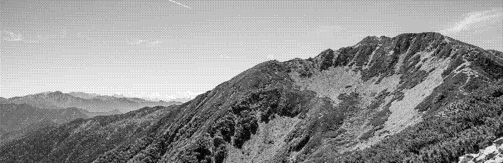

[Mt. Senjo · from Kitazawa Pass](https://note.com/yamayagi/n/nf8fc382f728a?hl=en)

# Farhan Naeem

Second-year CS @ McMaster University  
VP of Tech & Operations @ McMaster Start Coding  
Hackathon projects: Ploutos (Hack Canada 2026) · Sweepify (Hack404)  
Looking for research opportunities in CS

I'm driven by the chance to turn ideas into software that people can use. I want to keep learning across computer science, contribute to meaningful research, and build tools that solve concrete problems.

## Stack

**Languages**
         

**Frameworks & libraries**
        

**Tools & platforms**
     

## Stuff I built

| Project | What it is | Built with |
|---|---|---|
| EV Battery Health & Second-Life Tool | Estimated health for 106 fleet EV batteries within ~4% error and identified 63 reusable packs. | Python, HiGHS |
| Ploutos | Ranked 47+ Canadian cities using five live data sources and kept analysis available through AI outages with automatic fallback. | Next.js, FastAPI, Gemini, Backboard, React Flow |
| Sweepify | Logged 85+ verified Toronto cleanups by 40 members and classified six waste streams at 92% accuracy. | Next.js, Flask, Firebase, Google Maps API, PyTorch |

## Commits

---

[farhans.me](https://farhans.me) · [LinkedIn](https://ca.linkedin.com/in/farhan-naeem1) · [email](mailto:naeemf5@mcmaster.ca)
